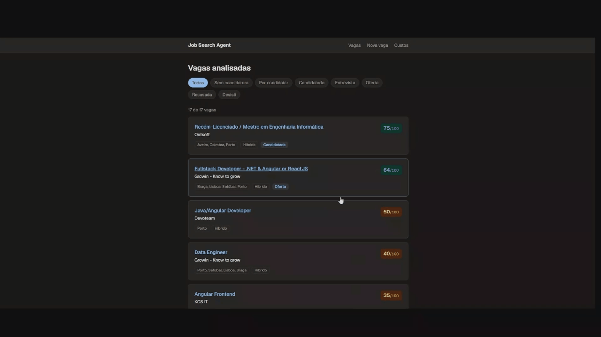

# job-search-agent

[](https://github.com/RubenSilva13/job-search-agent/actions/workflows/ci.yml)

<p align="center">
  
</p>

Agente de procura de emprego. Recebe o link de uma vaga, lê o anúncio, analisa o portfólio GitHub
e o perfil do utilizador, pesquisa a empresa e entrega um relatório estruturado: que requisitos
da vaga o utilizador cumpre, com a prova de cada um, um score de compatibilidade e sugestões.

O agente nunca se candidata sozinho: prepara a análise e quem decide é o utilizador.

Também faz uma varredura de vagas: com `python diario.py` recolhe as vagas mais recentes do ITJobs
(API oficial), filtra-as pelas preferências do perfil (cidade, regime, nível júnior, área) e analisa
as que passam, guardando tudo numa base de dados PostgreSQL.

Um painel em Next.js mostra as vagas por score, o relatório de cada uma, o acompanhamento das
candidaturas e os custos, e permite analisar uma vaga nova a partir do link.

## Como funciona

O ciclo do agente está escrito à mão, sem LangChain nem outros frameworks de agentes, para se
perceber cada passo. Usa o formato de ferramentas da API da Anthropic (`tool_use` / `tool_result`).

1. O modelo recebe a tarefa e decide que ferramenta usar.
2. O código executa a ferramenta e devolve o resultado ao modelo.
3. O ciclo repete-se até o modelo entregar o relatório, ou até acabarem os passos.

O modelo decide o que fazer; o código garante o que tem de acontecer sempre:

- **Validação do relatório:** o relatório é um modelo Pydantic. Se o modelo entregar algo inválido
  (por exemplo, um requisito como "cumpre" sem evidência), o erro volta ao modelo para ele se corrigir.
- **Limite de passos:** no último passo, o modelo é obrigado a entregar o relatório.
- **Cache:** uma ferramenta chamada duas vezes com os mesmos argumentos não é executada outra vez
  na mesma análise. O portfólio do GitHub fica ainda guardado em memória durante 30 minutos, para
  ser lido uma só vez por execução e não uma vez por vaga.
- **Registo:** cada análise guarda na base de dados a duração, os tokens, o custo estimado e cada
  passo (chamada ao modelo ou ferramenta), mesmo quando falha a meio.
- **Sem exagerar:** só conta o que está escrito nos READMEs e no perfil. Cada requisito cumprido
  indica a origem da prova e respeita o nível indicado no perfil.

## Ferramentas

| Ferramenta | O que faz |
|---|---|
| `ler_pagina_web` | Lê o texto de uma página (anúncio da vaga, site da empresa) |
| `pesquisar_web` | Pesquisa na web (DuckDuckGo) |
| `ler_portfolio` | Lê todos os repositórios públicos do GitHub, com o README de cada um |
| `listar_repositorios`, `ler_readme`, `ler_varios_readmes` | Versões mais finas do GitHub |
| `ler_perfil` | Lê o perfil da base de dados: formação, línguas, experiência e competências com o nível |
| `entregar_relatorio` | Entrega o relatório final (validado com Pydantic) |

## Relatório

Cada requisito do anúncio recebe um estado:

- ✅ `cumpre`: há prova clara num repositório ou no perfil
- 🟡 `parcial`: há prova de algo próximo, ou o perfil indica um nível inferior ao pedido
- ❌ `falta`: competência técnica que não aparece em lado nenhum
- ❔ `nao_confirmado`: algo que nem o GitHub nem o perfil mostram, como soft skills

O relatório inclui ainda o score (0 a 100), um resumo da empresa e sugestões. Fica guardado em
JSON na pasta `relatorios/`, com o link da vaga.

O score é calculado em código a partir dos estados, e não escrito pelo modelo: a percentagem dos
requisitos técnicos cumpridos, em que um requisito `parcial` vale metade e os `nao_confirmado` não
contam. Mede quanto do que o anúncio pede está provado no GitHub e no perfil. Não mede o interesse
da vaga nem a vontade de aprender o que falta.

## Custos e tempos

No fim de cada análise aparece uma linha, por exemplo:

```
📊 2 chamadas ao modelo, 22,500 tokens, ~$0.0042, 28 s (ok)
```

`python custos.py` junta tudo o que ficou registado: total e média por análise, custo por dia, as
ferramentas mais lentas, onde vai o tempo e as análises mais caras. Com o `claude-haiku-5-5`, uma
análise custa cerca de 0,4 cêntimos.

As medições serviram para otimizar o agente (valores médios, em 3 a 6 análises por fase, por isso
são indicativos e não uma experiência controlada):

| | Ponto de partida | Cache do portfólio | Cache + uma pesquisa por análise |
|---|---|---|---|
| Leitura do portfólio | 10,7 s | 2,9 s | 2,9 s |
| Chamadas ao modelo por análise | 2,0 | 3,3 | 2,0 |
| Tempo total por análise | 37,3 s | 35,0 s | 27,9 s |
| Custo médio por análise | 0,42 ¢ | 0,59 ¢ | 0,42 ¢ |

A cache sozinha encurtou a leitura do portfólio mas não o tempo total: nessa fase o agente passou a
fazer pesquisas a mais, e cada chamada extra ao modelo reenvia todo o histórico. O limite de uma
pesquisa, escrito nas instruções do agente, corrigiu-o.

## Avaliação

Para saber se o score serve, classifiquei vagas à mão e comparei com o que o agente diz.

- Classifiquei cada vaga **sem ver o score**: `serve`, `talvez` ou `nao` (candidatava-me?). No
  conjunto de teste, também a `cobertura` (`alta`, `media`, `baixa`): quanto do que a vaga pede já
  está provado no GitHub e no perfil, sem contar o interesse.
- Cada vaga foi analisada **3 vezes**, para medir também a estabilidade.
- Dois conjuntos: 24 vagas para desenvolver, e 15 vagas **que nem o agente nem eu tínhamos visto**,
  usadas uma só vez e sem mexer no agente depois de as classificar.

| | 24 vagas (desenvolvimento) | 15 vagas (teste) |
|---|---|---|
| Análises | 72 | 45 |
| Correlação com o meu interesse | 0,55 (0,18 a 0,82) | 0,53 (0,00 a 0,82) |
| Correlação com a cobertura | | 0,49 (−0,07 a 0,84) |
| Separação serve / nao | 0,87 (0,60 a 1,00) | 1,00 (12 pares em 12) |
| Score médio serve / talvez / nao | 50 / 35 / 17 | 55 / 36 / 33 |
| Oscilação média entre repetições | 12,9 pontos | 8,1 pontos |

Entre parênteses, os intervalos de 95%. O primeiro conjunto avaliou o score escrito pelo modelo. Foi
com esses resultados que o score passou a ser calculado em código, e o conjunto de teste avalia essa
versão.

**O que mostra**
- O score ordena as vagas de forma coerente com o meu julgamento nos dois conjuntos. No teste,
  todas as vagas `serve` ficaram acima de todas as `nao`; se os scores fossem ao acaso, isso
  aconteceria cerca de 3% das vezes.
- Calcular o score em código baixou a oscilação de 12,9 para 8,1 pontos. Nos relatórios antigos, o
  modelo nem sempre seguia a sua própria regra de cálculo.

**O que não mostra**
- Os intervalos das correlações tocam o zero: com 15 vagas não se pode afirmar que a correlação é
  diferente de zero, só que a direção é positiva nos dois conjuntos.
- O agente não distingue `talvez` de `nao` no teste (36 contra 33). Encontra as boas, não as
  intermédias.
- O que ainda oscila é a classificação dos requisitos (`falta` contra `nao_confirmado`). Com poucos
  requisitos contáveis, um só que mude de categoria move o score 17 a 33 pontos.
- O score mede a cobertura comprovada, e não o interesse. Marco `serve` em vagas em que teria de
  aprender o que falta, e o agente vê isso como `falta`. Neste conjunto as minhas duas notas
  correlacionam-se 0,70, por isso não se conseguiu separar o que o score acompanha melhor.
- Um só avaliador, e poucas vagas. Os resultados indicam uma direção e não são uma prova.

O método, os ficheiros e as regras para repetir a avaliação estão em
[avaliacao/README.md](avaliacao/README.md).

## Painel

O painel é uma aplicação Next.js (React, TypeScript e Tailwind) que lê a base de dados através de
uma API pequena em FastAPI (`api.py`).

| Página | O que mostra |
|---|---|
| `/` Vagas | As vagas analisadas, da maior para a menor pontuação, com o score a cores e o estado da candidatura. Filtra por estado (sem candidatura, candidatado, entrevista, ...) |
| `/vagas/{id}` | O relatório completo: requisitos com a cor do estado e a prova de cada um, a empresa e as sugestões. Aqui escolho o estado da candidatura e escrevo notas |
| `/nova` | Colo o link de um anúncio e o agente analisa-o em segundo plano (cerca de 30 s). Quando acaba, abre o relatório |
| `/custos` | Custos e tempos das análises: totais, custo por dia (gráfico), ferramentas mais lentas e onde vai o tempo |

A API tem estes endpoints:

| Endpoint | O que faz |
|---|---|
| `GET /vagas` | Lista as vagas analisadas, com a análise mais recente e o estado da candidatura |
| `GET /vagas/{id}` | Uma vaga com o relatório completo |
| `PUT /vagas/{id}/candidatura` | Cria ou atualiza a candidatura (estado e notas) |
| `POST /analises` | Arranca a análise de um link, em segundo plano. Só corre uma de cada vez |
| `GET /analises/{id}` | Como vai a análise: `a_analisar`, `pronta` ou `erro` |
| `GET /custos` | Os mesmos números do `custos.py`, em JSON |

O painel é uma ferramenta pessoal: não tem contas nem login, e todas as vagas são analisadas contra o
meu perfil e o meu GitHub.

## Testes e CI

Os testes usam o `pytest` e não gastam dinheiro: nunca chamam o modelo.

| Ficheiro | O que testa |
|---|---|
| `tests/test_modelos.py` | O score (parcial a valer metade, `nao_confirmado` a não contar), os validadores da evidência, e que o modelo não consegue impor um score |
| `tests/test_filtro.py` | Os anos de experiência pedidos, a senioridade, as funções fora da área, o local e o regime. Apanhou um bug: uma vaga em Bragança passava como Braga |
| `tests/test_api.py` | As validações da API e a análise em segundo plano, com o agente e a base de dados substituídos por falsos |
| `tests/test_base_de_dados.py`, `tests/test_api_bd.py` | O SQL a sério, contra um PostgreSQL: as candidaturas, a ordem das vagas, os custos |

Os testes com base de dados correm numa base à parte, `job_search_teste`, que o `conftest.py` cria
sozinho: um teste nunca escreve na base real. Se o Docker estiver fechado, esses testes saltam com
um aviso.

A cada push, o GitHub Actions (`.github/workflows/ci.yml`) arranca um PostgreSQL, corre os testes,
verifica os tipos, o ESLint e o build do painel, e constrói as duas imagens Docker.

## Estrutura

```
agente.py           ciclo do agente, validação e apresentação do relatório
config.py           chaves, modelo e limites
ferramentas.py      ferramentas do GitHub e do perfil
ferramentas_web.py  ler páginas e pesquisar na web
modelos.py          Relatorio e Requisito (Pydantic, com validadores)
base_de_dados.py    ligação ao PostgreSQL: perfil, vagas e análises
schema.sql          tabelas da base de dados
recolha.py          recolhe vagas do ITJobs, filtra-as e guarda-as
filtro.py           decide se uma vaga serve (senioridade, anos pedidos, área, local e regime)
analise_diaria.py   analisa com o agente as vagas aceites que ainda não têm análise
diario.py           comando único: recolher, filtrar e analisar
custos.py           relatório de custos e tempos das análises (lê a base de dados)
api.py              API FastAPI: vagas, candidaturas, análise por link e custos
frontend/           painel em Next.js (as páginas estão em frontend/app; tem o seu Dockerfile)
tests/              testes com pytest (requirements-dev.txt e pytest.ini)
avaliacao/          avaliação do score contra vagas classificadas à mão (tem o seu README)
Dockerfile          imagem da API
docker-compose.yml  PostgreSQL e, com o profile "app", a API e o painel
.github/workflows/  a CI (GitHub Actions)
perfil.json         perfil do utilizador, carregado para a base de dados
ROADMAP.md          plano do projeto
```

## Como correr

Precisa de Python 3, do Docker e de uma chave da API da Anthropic.

```bash
python -m venv venv
venv\Scripts\activate          # Windows; em Linux/macOS: source venv/bin/activate
pip install -r requirements.txt
```

Cria um ficheiro `.env` na raiz:

```
ANTHROPIC_API_KEY=a-tua-chave
GITHUB_TOKEN=opcional
POSTGRES_PASSWORD=uma-palavra-passe-tua
ITJOBS_API_KEY=a-tua-chave
```

O `GITHUB_TOKEN` é opcional e só aumenta o limite de pedidos à API do GitHub. A chave do ITJobs
pede-se em [itjobs.pt/api](https://itjobs.pt/api).

Edita o `perfil.json` com os teus dados. Depois arranca a base de dados e carrega o perfil
(só é preciso repetir o segundo comando quando alteras o `perfil.json`):

```bash
docker compose up -d
python base_de_dados.py
```

Para fazer a varredura de vagas (precisa do Docker aberto):

```bash
python diario.py
```

Para ver quanto custaram e quanto demoraram as análises:

```bash
python custos.py
```

Para ver o painel (precisa do Docker aberto e do Node.js), em dois terminais:

```bash
uvicorn api:app --reload      # a API, em http://127.0.0.1:8000 (com o venv ativo)
```

```bash
cd frontend
npm install                   # só da primeira vez
npm run dev                   # o painel, em http://localhost:3000
```

Ou tudo em Docker (base de dados, API e painel), sem precisar do Python nem do Node no PC. Lê as
chaves do `.env`:

```bash
docker compose --profile app up -d --build    # o painel em http://localhost:3000
docker compose --profile app stop api frontend   # para parar a API e o painel
```

Para correr os testes (com o venv ativo; os que usam a base de dados precisam do Docker aberto):

```bash
pip install -r requirements-dev.txt    # só da primeira vez
pytest
```

Para analisar uma vaga em concreto, o nome de utilizador do GitHub indica-se na tarefa:

```bash
python agente.py
```

Escreve a tarefa quando o programa pedir, por exemplo:

```
Analisa esta vaga para o utilizador do GitHub RubenSilva13: https://exemplo.com/vaga
```

## Limitações conhecidas

- Páginas que exigem login (como o LinkedIn) ou que carregam o conteúdo com JavaScript não são
  lidas. Funciona melhor com anúncios em sites de empresas e plataformas abertas.
- O agente só conhece o que está no GitHub e no perfil guardado na base de dados. Não lê o CV.
- O score é calculado em código, mas os estados dos requisitos ainda variam entre execuções: a
  oscilação média é de cerca de 8 pontos, e pode passar de 30 em vagas com poucos requisitos
  contáveis. Ver a secção Avaliação.
- Se a base de dados estiver desligada, o `diario.py` avisa e termina com código de erro.
- A recolha só usa o ITJobs. O filtro é uma heurística (palavras no título e anos de experiência
  pedidos no texto), por isso pode deixar passar vagas sénior ou recusar vagas boas.
- O campo `workModel` do ITJobs (0, 1, 2) foi interpretado como presencial, remoto e híbrido, mas
  isso não está confirmado pela fonte.
- O limite de uma pesquisa web por análise é uma instrução ao modelo, não uma garantia do código.
- O custo é uma estimativa: tokens devolvidos pela API vezes a tabela de preços do `config.py`
  (verificada em 2026-11-03), que convém rever de vez em quando.
- A API não tem autenticação, e cada análise pedida no painel gasta a chave da Anthropic. Serve para
  correr em local; para publicar, a escrita (`/nova` e as candidaturas) teria de ficar desligada ou
  protegida.
- Uma análise pedida no painel fica registada em memória: se a API reiniciar a meio (por exemplo,
  com o `--reload` ao gravar um ficheiro), perde-se o seguimento dessa análise.
- O painel não está publicado online. Corre em local (ou em Docker na própria máquina), porque cada
  análise gasta a chave da Anthropic e não há contas nem login.

## Estado e próximos passos

Concluído: ciclo do agente com ferramentas do GitHub, ferramentas web, relatório estruturado com
Pydantic, migração para a API do Claude, base de dados PostgreSQL (em Docker) com o perfil, as
vagas e as análises, a recolha, filtro e análise de vagas do ITJobs com um só comando, e o registo de
duração, tokens e custo de cada análise, a avaliação do score contra vagas classificadas à mão, e o
painel em Next.js com a API em FastAPI, os testes, a CI e o Docker.

O plano de 8 fases está concluído. O que ficou por fazer, e porquê, está no [ROADMAP.md](ROADMAP.md).
